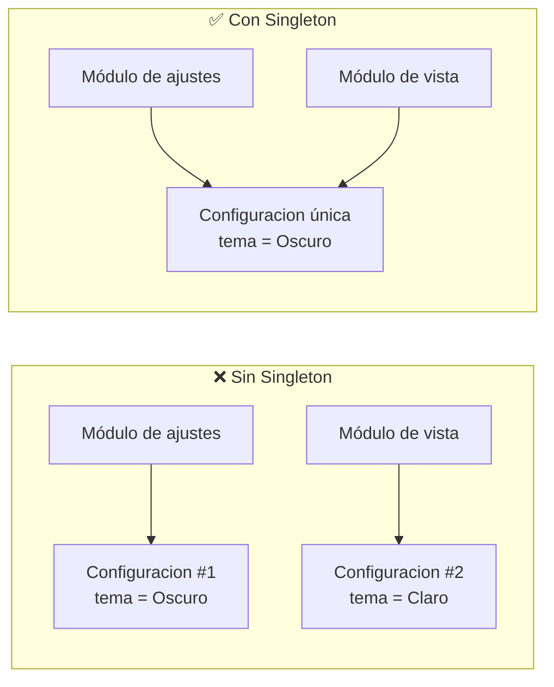
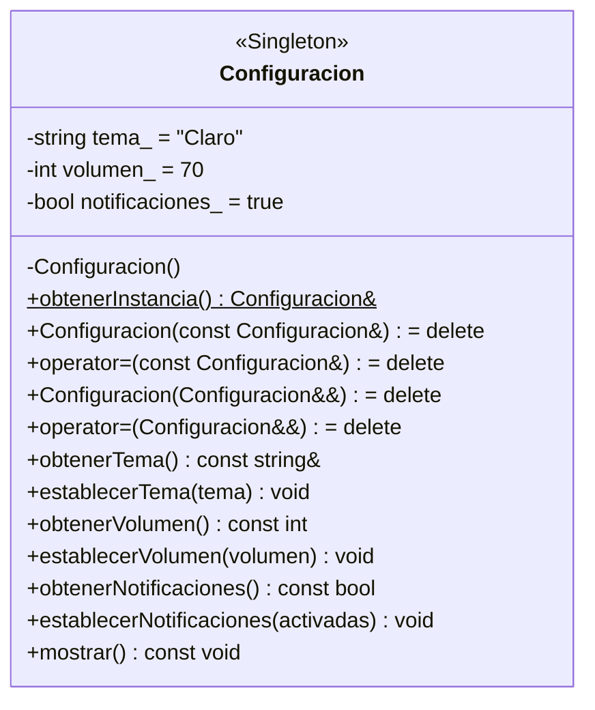
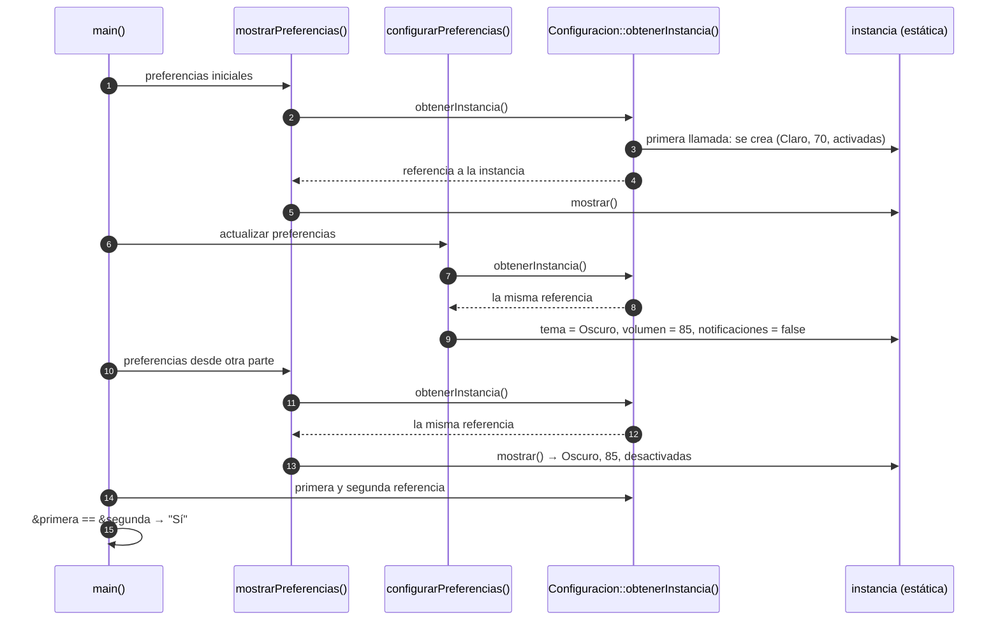
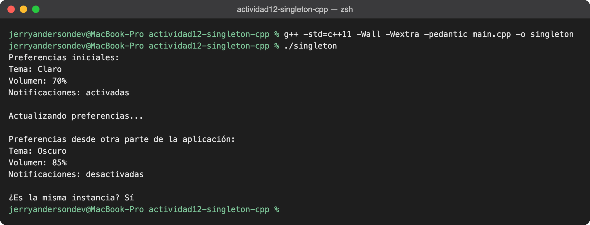
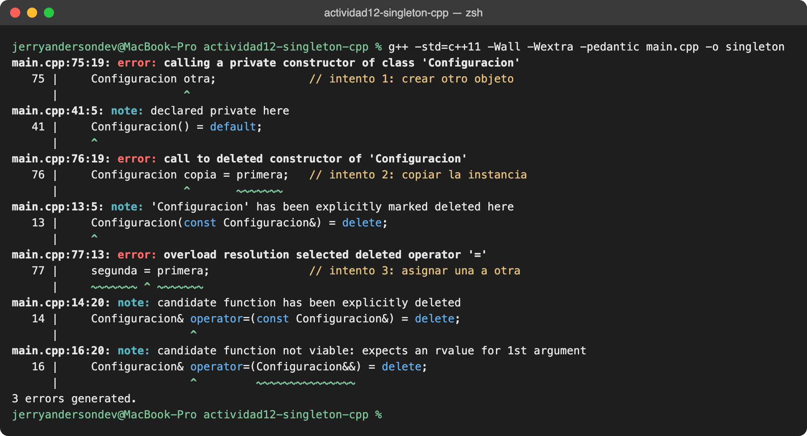

<div align="center">

# Actividad N.º 12 · Patrón Singleton en C++

**Configuración global de una aplicación de escritorio con una única instancia compartida**


</div>

| | |
|---|---|
| **Universidad** | Universidad Nacional de San Agustín de Arequipa |
| **Escuela** | Ingeniería de Sistemas · Facultad de Ingeniería de Producción y Servicios |
| **Curso** | Tecnología de Objetos |
| **Docente** | Mg. Maribel Molina Barriga |
| **Grupo** | Grupo 1 |
| **Informe** | [`informe/Actividad12_Singleton_Grupo1.pdf`](informe/Actividad12_Singleton_Grupo1.pdf) |

---

## Contenido
1. [Introducción](#1-introducción)
2. [Objetivos](#2-objetivos)
3. [Descripción del problema](#3-descripción-del-problema)
4. [Diseño de la solución](#4-diseño-de-la-solución)
5. [Elementos del patrón utilizados](#5-elementos-del-patrón-utilizados)
6. [Implementación](#6-implementación)
7. [Flujo de ejecución](#7-flujo-de-ejecución)
8. [Compilación y ejecución](#8-compilación-y-ejecución)
9. [Resultados](#9-resultados)
10. [Ventajas y consideraciones](#10-ventajas-y-consideraciones)
11. [Conclusiones](#11-conclusiones)
12. [Estructura del repositorio](#12-estructura-del-repositorio)
13. [Integrantes](#13-integrantes)
14. [Referencias](#14-referencias)

---

## 1. Introducción

Los patrones de diseño ofrecen soluciones conocidas para problemas frecuentes al organizar software. **Singleton** es un patrón **creacional** que garantiza que una clase tenga **una sola instancia** y proporciona un **punto de acceso global** a ella.

En esta actividad se aplica a la clase `Configuracion`, que concentra las preferencias de una aplicación de escritorio: **tema**, **volumen** y **notificaciones**.

## 2. Objetivos

- Aplicar el patrón Singleton en C++.
- Centralizar las preferencias globales de tema, volumen y notificaciones.
- Usar clases, encapsulamiento y control de la creación de objetos.
- Explicar el funcionamiento del patrón mediante un ejemplo ejecutable.

## 3. Descripción del problema

En una aplicación, distintas partes necesitan consultar o modificar las mismas preferencias. Si cada parte creara **su propio** objeto de configuración, los valores podrían ser diferentes y producir resultados inconsistentes:



Con Singleton, todas las partes acceden a **un único objeto compartido**, y un cambio hecho en un módulo se ve inmediatamente en los demás.

## 4. Diseño de la solución



- El **constructor privado** impide crear objetos desde fuera de la clase.
- El método **estático** `obtenerInstancia()` devuelve una **referencia** a una variable estática local, que se crea una sola vez.
- Los **atributos privados** solo se consultan o modifican mediante métodos públicos; el volumen se restringe al rango **0–100**.

> **Idea clave:** las funciones que representan distintas partes de la aplicación llaman a `Configuracion::obtenerInstancia()` y trabajan con el mismo objeto.

## 5. Elementos del patrón utilizados

| Elemento | Implementación | Qué garantiza |
|----------|----------------|---------------|
| **Instancia única** | `static Configuracion instancia;` dentro de `obtenerInstancia()` | El objeto se crea una sola vez, en la primera llamada |
| **Acceso global** | `static Configuracion& obtenerInstancia()` público | Cualquier parte del programa obtiene la instancia sin crearla |
| **Creación controlada** | `Configuracion() = default;` en la sección `private` | Nadie fuera de la clase puede crear otro objeto |
| **Sin duplicados** | Constructor y operador de copia/movimiento con `= delete` | No se puede copiar ni mover la instancia |
| **Encapsulamiento** | Atributos `private` + getters `const` y setters públicos | Los datos solo cambian de forma controlada |
| **Validación** | `establecerVolumen()` ajusta los valores fuera de 0–100 | El volumen nunca queda en un estado inválido |

## 6. Implementación

Todo el código está en [`main.cpp`](main.cpp).

### Punto de acceso a la única instancia

```cpp
static Configuracion& obtenerInstancia() {
    static Configuracion instancia;   // se crea una sola vez
    return instancia;                 // siempre la misma referencia
}

private:
    Configuracion() = default;        // nadie más puede construirla
```

La variable estática local se inicializa la **primera vez** que se ejecuta la función y se conserva durante toda la ejecución. Desde **C++11** esta inicialización es **segura ante llamadas concurrentes** (*thread-safe*): si dos hilos llaman a la vez, solo uno crea el objeto.

### Prohibir copias y movimientos

```cpp
Configuracion(const Configuracion&) = delete;             // copia
Configuracion& operator=(const Configuracion&) = delete;  // asignación
Configuracion(Configuracion&&) = delete;                  // movimiento
Configuracion& operator=(Configuracion&&) = delete;       // asignación por movimiento
```

Sin estas líneas, se podría escribir `Configuracion copia = Configuracion::obtenerInstancia();` y tener una **segunda** configuración, lo que rompería el patrón.

### Encapsulamiento y validación

```cpp
private:
    std::string tema_ = "Claro";
    int volumen_ = 70;
    bool notificaciones_ = true;

public:
    void establecerVolumen(int volumen) {
        if (volumen < 0) volumen_ = 0;
        else if (volumen > 100) volumen_ = 100;
        else volumen_ = volumen;
    }
```

| Llamada | Valor guardado |
|---------|----------------|
| `establecerVolumen(85)` | 85 |
| `establecerVolumen(-10)` | 0 |
| `establecerVolumen(150)` | 100 |

### Dos "módulos" que comparten la configuración

```cpp
void configurarPreferencias() {          // módulo que modifica
    Configuracion& config = Configuracion::obtenerInstancia();
    config.establecerTema("Oscuro");
    config.establecerVolumen(85);
    config.establecerNotificaciones(false);
}

void mostrarPreferencias() {             // módulo que solo consulta
    const Configuracion& config = Configuracion::obtenerInstancia();
    config.mostrar();
}
```

`mostrarPreferencias()` recibe una referencia **`const`**: solo puede llamar a métodos de consulta como `mostrar()`.

## 7. Flujo de ejecución



## 8. Compilación y ejecución

Requisito: compilador con soporte para **C++11** o superior (`g++`, `clang++` o MinGW en Windows).

```bash
git clone https://github.com/JerryCode777/actividad12-singleton-cpp.git
cd actividad12-singleton-cpp

# Opción 1: directamente con g++
g++ -std=c++11 -Wall -Wextra -pedantic main.cpp -o singleton
./singleton

# Opción 2: con make
make run
```

> En Windows: `singleton.exe`. Si las tildes se ven mal, ejecutar antes `chcp 65001`.

## 9. Resultados

### Salida del programa

```text
Preferencias iniciales:
Tema: Claro
Volumen: 70%
Notificaciones: activadas

Actualizando preferencias...

Preferencias desde otra parte de la aplicación:
Tema: Oscuro
Volumen: 85%
Notificaciones: desactivadas

¿Es la misma instancia? Sí
```

<p align="center"></p>

- `configurarPreferencias()` cambia los valores y `mostrarPreferencias()` los ve, aunque son funciones distintas: **ambas usan el mismo objeto**.
- La última línea compara las direcciones de dos referencias obtenidas con `obtenerInstancia()`: son iguales, así que se trata de **la misma instancia**.

### Comprobación: no se puede crear otra instancia

Si en `main()` se intenta crear, copiar o asignar una `Configuracion`:

```cpp
Configuracion otra;              // intento 1: crear otro objeto
Configuracion copia = primera;   // intento 2: copiar la instancia
segunda = primera;               // intento 3: asignar una a otra
```

el **compilador rechaza el programa**, de modo que el error se detecta antes de ejecutarlo:

<p align="center"></p>

| Intento | Error del compilador | Elemento del patrón que lo impide |
|---------|----------------------|-----------------------------------|
| `Configuracion otra;` | *calling a private constructor* | Constructor privado |
| `Configuracion copia = primera;` | *call to deleted constructor* | Constructor de copia `= delete` |
| `segunda = primera;` | *overload resolution selected deleted operator '='* | Asignación `= delete` |

## 10. Ventajas y consideraciones

| ✅ Ventajas | ⚠️ Consideraciones |
|------------|-------------------|
| Evita tener distintas copias de una configuración que debe ser compartida | El acceso global aumenta el **acoplamiento** entre componentes |
| Ofrece un punto de acceso sencillo desde cualquier parte del programa | Dificulta las **pruebas unitarias**, porque el estado se comparte entre pruebas |
| La inicialización local estática es simple y **segura entre hilos** desde C++11 | Conviene reservarlo para recursos que **realmente** deben ser únicos |
| El objeto se crea solo cuando se necesita por primera vez (*lazy initialization*) | Que la creación sea segura no hace seguros los setters si varios hilos modifican a la vez |

## 11. Conclusiones

- Se implementó Singleton mediante una clase con **constructor privado** y un **método estático de acceso** que devuelve una variable estática local.
- Las funciones del ejemplo consultan y actualizan **las mismas preferencias**, lo que muestra el propósito de una instancia única.
- Los atributos privados, los métodos de acceso y la validación del volumen aplican **encapsulamiento**.
- La comparación de direcciones demuestra que las llamadas a `obtenerInstancia()` retornan **el mismo objeto**, y los errores de compilación demuestran que **no se puede crear otro**.

## 12. Estructura del repositorio

```
actividad12-singleton-cpp/
├── main.cpp                        Código fuente completo (clase Configuracion y ejemplo)
├── Makefile                        make / make run / make clean
├── docs/
│   └── img/
│       ├── ejecucion.png           Captura de la compilación y ejecución
│       └── error-copia.png         Captura de los errores al intentar copiar
├── informe/
│   └── Actividad12_Singleton_Grupo1.pdf
└── README.md
```

## 13. Integrantes

| Apellidos y nombres | Usuario GitHub |
|---------------------|----------------|
| Huaynacho Mango Jerry Anderson | [@JerryCode777](https://github.com/JerryCode777) |
| Quispe Mamani Jose Gabriel | [@J-Gabriel-Quispe-M](https://github.com/J-Gabriel-Quispe-M) |
| Ramos Ochochoque Elkin Eder B. | [@elkinramos8](https://github.com/elkinramos8) |
| Schreiber Landeo Diego Hans | [@Diego-Schreiber](https://github.com/Diego-Schreiber) |
| Solsol Choque Fernando Rafael | [@Fernando-Solsol](https://github.com/Fernando-Solsol) |

## 14. Referencias

- Gamma, E., Helm, R., Johnson, R. y Vlissides, J. (1994). *Design patterns: Elements of reusable object-oriented software*. Addison-Wesley.
- cppreference.com. (s. f.). *Storage class specifiers: static local variables*. https://en.cppreference.com/w/cpp/language/storage_duration#Static_local_variables
- cppreference.com. (s. f.). *Deleted functions*. https://en.cppreference.com/w/cpp/language/function#Deleted_functions
- Refactoring.Guru. (s. f.). *Singleton*. https://refactoring.guru/es/design-patterns/singleton

---

<div align="center"><sub>Proyecto académico · UNSA · Tecnología de Objetos · 2026</sub></div>
